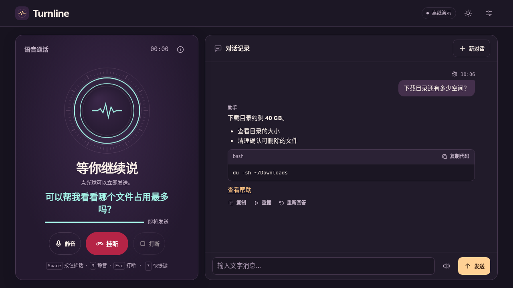
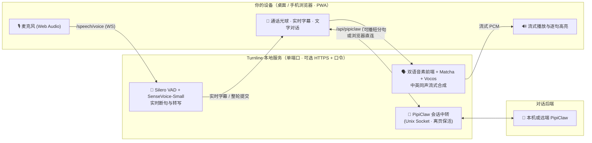

<div align="center">


# Turnline

**为 PipiClaw 打造的本地中英双语语音通话与文字对话界面**

打开浏览器就能跟你的 AI 助手打电话——语音识别与合成全部跑在你自己的 CPU 上，无需云端语音服务；挂断或刷新后也能在同一会话里无缝切回打字、查看推理进展并继续追问。

<p>
  
  
  
  <a href="https://github.com/oyasmi/pipiclaw"></a>
</p>

**[为什么用它](#为什么用-turnline) · [真实体验](#真实通话体验) · [快速开始](#快速开始) · [核心能力](#核心能力) · [常用命令](#常用命令) · [常见问题](#常见问题) · [文档导航](#文档导航)**

<br>

<picture>
  <source media="(prefers-color-scheme: dark)" srcset="test/screenshots/1280x720-dark-call.png">
  <source media="(prefers-color-scheme: light)" srcset="test/screenshots/1280x720-light-call.png">
  
</picture>

</div>

---

## 为什么用 Turnline

把语音交互真正用进日常研发与思考时，常见方案往往卡在三个地方：

1. **云端语音既慢又交出隐私**：动辄依赖云端 ASR / TTS API，录音要发到第三方，还有额外账单与网络抖动。
2. **中英混排和工程术语听不下去**：中文说到一半夹个 `API`、`v2.0.3`、`40 GB` 或命令行参数，很多语音引擎要么卡壳、要么音色割裂。
3. **语音和文字是两张皮**：语音窗口里说不清代码和路径，想打字又要重开会话；或者稍微停顿思考一下就被抢话，一关页面正在跑的后端任务就断了联系。

**Turnline 把自然语音通话和工程级文字协作放进同一条会话时间线**：它在你自己的机器上用普通 CPU 完成本地收音断句、SenseVoice 识别与 Matcha 双语流式播报，零配置中转本机 [PipiClaw](https://github.com/oyasmi/pipiclaw)，同时提供可独立运行的原生 Android 客户端。

| 对比维度 | 云端语音助手 | 纯文字聊天界面 | **Turnline** |
| --- | --- | --- | --- |
| **语音识别与合成** | 依赖云端 API，录音外传且按量计费 | 无语音交互 | **100% 本地 CPU 离线运行（SenseVoice + Matcha + Vocos）** |
| **中英混读与术语** | 中英文常切音色或错读数字/版本 | 只能看字 | **同一副音色流式混读中英文、版本号、容量与代码术语** |
| **断句与插话体验** | 停顿半秒就抢话，或必须手动点按 | 仅限打字 | **自适应停顿等待、随时停播、任务进行中开口/打字补充** |
| **语音与文字协同** | 独立语音气泡，难查代码和工具记录 | 无法解放双手 | **同一会话无缝切换，实时展开工具进度与推理摘要** |
| **长耗时任务续接** | 退出通话或刷新即丢失现场 | 依赖页面常驻 | **挂断、刷新或切会话不中断任务，重开自动续接进展** |

---

## 真实通话体验

下面是配合 PipiClaw 日常使用 Turnline 的典型一幕：

```text
21:10  [书房 · 浏览器开麦]
你 ──▶ "帮我看一下下载目录还剩多少空间……嗯，顺便把占用最大的前五个文件列出来。"
       （句中停顿与思考词自动等待，不会提前抢话，实时字幕同步出现）

21:11  [边执行边播报 · 中途补充]
助手 ─▶ 边调用工具边流式朗读首句结论，对话区同步展开工具耗时与命令输出。
你 ──▶ 不必等它跑完，直接插话或打字："跳过 .iso 镜像文件，只看安装包。"
       （界面提示「已插入正在进行的工作」，当前回合顺着新要求继续）

21:12  [挂断切回文字 · 离页不中断]
你 ──▶ 点「挂断」退回安静阅读，直接复制回复里的 bash 命令；
       就算刷新浏览器或切去别的会话，后台回合依然继续，切回来自动续接结果。
```

除此之外，你还可以用它做：

- **🎧 解放双手的头脑风暴**：开启自动断句，边踱步边口述需求；嘈杂环境下可一键切换为「按住说话」（桌面按住 `Space`，手机按住光球）。
- **🔇 语音文字自由混搭**：通话中不方便念代码或路径时，直接在底部输入框粘贴发送；想只看字不听声，点输入框旁扬声器图标关闭本轮朗读。
- **📱 手机随时开聊**：局域网或公网部署后直接用手机浏览器安装为 PWA；或使用仓库自带的原生 **Android 客户端**，支持锁屏后台通话与手机端离线 Matcha 播报。
- **🔍 延迟透明可测**：点通话区右上角信息图标即可打开「通话诊断」，查看停说到首声、识别、推理与合成的逐阶段耗时。

---

## 快速开始

开始前请准备 [uv](https://docs.astral.sh/uv/)，以及 Chrome 或 Edge 浏览器。

<details>
<summary>💡 <b>偷懒捷径：把这段话发给本机的 Claude Code / Codex / Cursor，让它帮你装好</b></summary>

```text
请帮我安装并启动当前目录的 Turnline：

1. 检查 uv 是否已安装；若缺少请提示我安装方法后停止。
2. 在仓库根目录执行 make setup（安装 Python 依赖并下载本地语音模型到 models/）。
3. 检查本机是否存在 ~/.pipiclaw/state/webapi/api.sock：
   - 如果存在，询问我是否直接运行 make run 连接本机 PipiClaw；
   - 如果不存在，先运行 make demo 让我体验离线演示模式。
4. 启动后告诉我浏览器访问地址（默认 http://127.0.0.1:8686），并如实汇报执行结果。
```

</details>

### 第 1 步：60 秒体验演示模式（无需 PipiClaw）

在仓库根目录执行两行命令，即可完成依赖安装、模型下载并进入独立演示模式：

```bash
make setup
make demo
```

首次运行会安装 Python 依赖并将语音模型下载到 `models/`（等价命令：`uv sync --locked --python 3.13 && uv run python setup_models.py && uv run python server.py --demo`）。启动后打开 <http://127.0.0.1:8686>，点击「开始通话」或直接打字即可体验完整语音交互。

### 第 2 步：连接本机 PipiClaw

启动本机 [PipiClaw](https://github.com/oyasmi/pipiclaw) Web API 后，直接运行：

```bash
make run
```

Turnline 默认通过 `~/.pipiclaw/state/webapi/api.sock` 自动中转，无需任何额外配置。若 PipiClaw 运行在另一台机器上，可在页面右上角「通话设置」中切换到「浏览器直连」，或运行 `make direct` 启动纯直连模式。

### 第 3 步：手机、局域网或公网部署（内置 HTTPS 与口令保护）

跨设备访问 Web 版时，浏览器要求使用受信任的 HTTPS 才能开启麦克风。Turnline 单进程内置了自签证书、正式证书加载、HSTS 与口令访问控制，无需额外部署 Nginx 或 Caddy：

```bash
# 局域网部署：首次设置访问口令（至少 8 位），随后后台启动并自动签发本地 HTTPS 证书
make auth-set STATE_DIR=~/.local/state/turnline-lan
make start MODE=lan

# 公网部署：使用 Let's Encrypt 等正式证书，在独立端口后台启动
make auth-set STATE_DIR=~/.local/state/turnline-public
make start MODE=public PUBLIC_PORT=8687 \
  TLS_CERT=/etc/letsencrypt/live/your.domain/fullchain.pem \
  TLS_KEY=/etc/letsencrypt/live/your.domain/privkey.pem
```

> [!TIP]
> 局域网自签模式下，启动日志会打印本地 CA 证书路径，导入手机或电脑系统信任库后即可正常开麦。完整的反向代理、SSH 隧道、口令管理与排障指南见 **[连接与部署](docs/deployment.md)**。

### 第 4 步：原生 Android 客户端（可选）

如果你更希望用手机原生 App 直接连接 PipiClaw 或任意兼容的 OpenAI Responses API（**无需运行 Turnline Python 服务**），可直接构建并安装 `clients/android/`：

```bash
make android-install
```

支持 Android 12+、锁屏后台通话与内置离线 Matcha 中英播报，详见 **[Android 使用与构建](docs/android.md)**。

---

## 核心能力

### 🎙️ 1. 自然轮次与抗误触发收音

- **自适应断句**：结合 Silero VAD 与 SenseVoice-Small，区分完整句尾与句中停顿（如「然后」「比如」），提供灵敏 / 均衡 / 耐心三档反应速度，也支持一键切换「按住说话」。
- **最短有效语音过滤**：默认过滤不足 2 秒的短噪声或咳嗽（可调 0–5 秒），句中停顿自动合并计数。
- **灵活打断与中途补充**：播报中点击光球、按 `Esc` 或开启「允许在播报时开口打断」即可停播；在服务端中转模式下，助手工作进行中可直接开口或打字补充要求，或说出「停止工作」取消当前回合。

### 🗣️ 2. 本地 CPU 中英同声流式合成

- **统一双语音素前端**：服务端使用 `matcha-icefall-zh-en` 与 Vocos 声码器，中文走归一化与 `pypinyin`，英文走 eSpeak NG，数字、日期、百分比、容量单位与版本号按统一规则展开，由同一副音色流式合成输出。
- **边生成边播报**：默认收到首个短分句即开始朗读，同步高亮当前朗读句并在打断时标出断点；也可切换为「确认正文后播报」避开中间进度句，支持 0.9×–1.15× 四档语速。

### 💬 3. 语音与文字同源会话，离页不中断

- **持久会话与后台续接**：对话记录由 PipiClaw 持久保存。服务端中转模式下，挂断通话、刷新页面、切换会话或关闭标签页均不会中断已提交的回合，重新打开原会话即可续接剩余进展。
- **工作进度与推理摘要**：耗时任务期间实时显示耗时、工具调用次数与当前操作，展开可查看工具结果预览与推理摘要；每条回复支持复制、重播与重新回答。

### 🔒 4. 单端口安全边界与轻量化访问控制

- **单进程全栈服务**：静态前端（无打包原生 ES Module + PWA）、语音 WebSocket、流式 PCM 与 PipiClaw 中转共用同一端口。
- **口令防爆破与一键吊销**：监听非回环地址时强制要求 HTTPS 并显式声明 `--auth`；`--auth passcode` 模式内置单 IP 渐进锁定、滑动续期 Cookie、实例级多设备共享历史，以及 `make auth-revoke` 一键吊销所有已登录设备。

### 📱 5. 独立可用的原生 Android 客户端

- **零依赖直连**：Kotlin + Jetpack Compose 编写，手机直接对接 PipiClaw（WebSocket 中途引导 + 断点续流 + 后台结果同步）或通用 Responses API。
- **锁屏通话与离线双语**：通话期间启用前台服务与通知栏快捷控制（暂停/继续/挂断），内置随 APK 打包的 Matcha + Vocos 离线双语播报引擎。

### 一张图看懂语音与对话链路



---

## 常用命令

仓库根目录的 `Makefile` 封装了日常全部操作（运行 `make` 或 `make help` 查看完整参数与示例）：

| 分组 | 命令 | 说明 |
| --- | --- | --- |
| **初始化与运行** | `make setup` / `make models` | 安装 Python 依赖并下载/校验 `models/` 本地语音模型 |
| | `make demo` | 本机演示模式启动（`127.0.0.1:8686`，不依赖 PipiClaw） |
| | `make run` | 本机默认启动，自动中转本机 PipiClaw |
| | `make direct` | 本机纯浏览器直连模式启动（`--direct-only`） |
| **内网 / 公网与口令** | `make run-lan` / `make run-public` | 前台启动局域网自签 HTTPS 或公网正式证书 HTTPS 服务 |
| | `make auth-set` / `auth-status` / `auth-revoke` | 设置或修改口令、查看已认证会话数、一键吊销所有已登录设备 |
| **后台常驻脚本** | `make start` / `stop` / `restart` | 后台启停服务（`MODE=local\|lan\|public`，支持多实例并存） |
| | `make status` / `make logs` | 查看后台服务运行状态与实时日志 |
| **测试与 Android** | `make test` / `make test-all` | 运行 Python + Node 单测，或全套自动化测试（含浏览器语音与界面截图回归） |
| | `make android-debug` / `android-install` / `android-release` | 构建、安装 Debug APK 或构建未签名 Release APK |

---

## 常见问题

<details>
<summary><b>1. 运行 Turnline 需要独立显卡（GPU）或云端语音 API Key 吗？</b></summary>

**都不需要。** 语音活动检测（Silero VAD）、语音识别（SenseVoice-Small）和双语语音合成（Matcha + Vocos）全部在普通 CPU 上本地运行，默认 2 线程即可流畅流式播报（可通过 `--tts-threads` 调整）。
</details>

<details>
<summary><b>2. 为什么用手机或局域网 IP 打开网页时，提示无法开启麦克风？</b></summary>

现代浏览器出于安全策略，只允许在 `localhost` / `127.0.0.1` 或**受设备信任的 HTTPS** 站点下调用麦克风。局域网访问请使用 `make run-lan`（或 `make start MODE=lan`），并将启动日志里打印的本地 CA 证书导入手机/电脑系统信任库后重启浏览器。详见 [连接与部署](docs/deployment.md)。
</details>

<details>
<summary><b>3. 挂断通话、刷新浏览器或切到别的会话，正在执行的 PipiClaw 任务会停吗？</b></summary>

**不会。** 在默认的服务端中转模式下，挂断只关闭语音通道，刷新或切会话只解除前端订阅；已提交的回合会由 Turnline 中转与 PipiClaw 继续推进，重新打开原会话即可续接剩余进展与结果。若确实要取消，可点「停止工作」或在通话中说出「停止工作」。
</details>

<details>
<summary><b>4. Web 版和原生 Android 客户端怎么选？需要同时运行吗？</b></summary>

两者互不依赖，按场景任选即可：
- **Web 版（主形态）**：适合电脑与手机浏览器（支持 PWA），语音识别与合成由你自己的机器承担，体验最完整（含自适应断句、通话诊断、多设备口令共享中转历史）。
- **Android 客户端**：独立 APK，**无需运行 Turnline Python 服务**，手机直连 PipiClaw 或通用 Responses API，支持锁屏后台通话与手机端离线 Matcha 播报。
</details>

<details>
<summary><b>5. 模型文件、口令和会话记录存在哪里？</b></summary>

- **语音模型**：下载在仓库根目录 `models/` 下，Web 与 Android 构建共享复用，不纳入 Git 追踪。
- **状态、口令与证书**：默认存于 `~/.local/state/turnline/`（内网/公网快捷命令分别落于 `turnline-lan` 与 `turnline-public`，可用 `--state-dir` 自定义）。
- **对话正文**：由 PipiClaw 持久保存；Turnline 仅记录会话归属与短期事件缓存用于断线续接。
</details>

---

## 文档导航

按你需要解决的问题直达对应手册：

| 你想做什么 | 对应指南 |
| --- | --- |
| 🎙️ 上手语音通话、中途插话、调整断句/语速/快捷键与通话诊断 | [Web 使用手册](docs/web-usage.md) |
| 🚀 配置本机中转、浏览器直连、局域网/公网 HTTPS、口令保护与后台常驻 | [连接与部署](docs/deployment.md) |
| 📱 连接与使用独立 Android 客户端、开启离线中英播报或自行构建 APK | [Android 使用与构建](docs/android.md) |
| 🏗️ 了解仓库结构、语音与对话数据流、会话隔离边界与双语发音链路 | [项目架构](docs/architecture.md) |
| 🧪 运行自动化回归、延迟/回声/后台保活专项压测与查看诊断计时口径 | [测试手册](docs/testing.md) |

> 历史背景材料：[历史验证记录](docs/test-results.md) · [语音合成选型调研](docs/research/tts-selection.md)

---

## 参与开发与测试

Web 端使用原生 ES Module（无前端打包步骤），自动化测试需要 `uv` 与 Node.js 22+：

```bash
make test      # Python 单元测试 + Node 协议与状态机测试
make test-all  # 额外运行真实语音模型浏览器端到端测试与 Playwright 界面截图/无障碍回归
```

完整架构与测试说明见 **[项目架构](docs/architecture.md)** 与 **[测试手册](docs/testing.md)**。欢迎提交 Issue 与 Pull Request！
